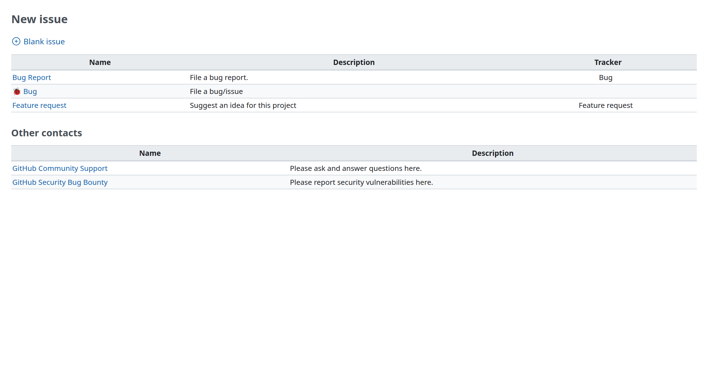
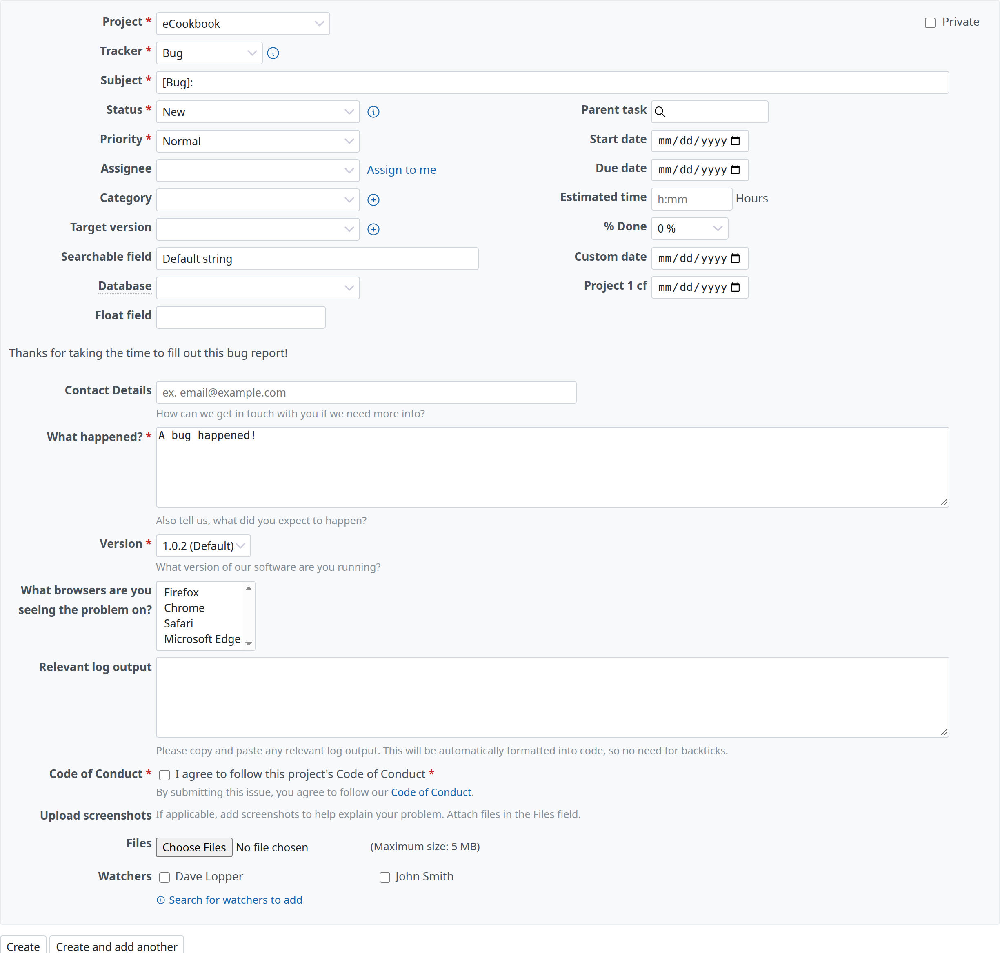
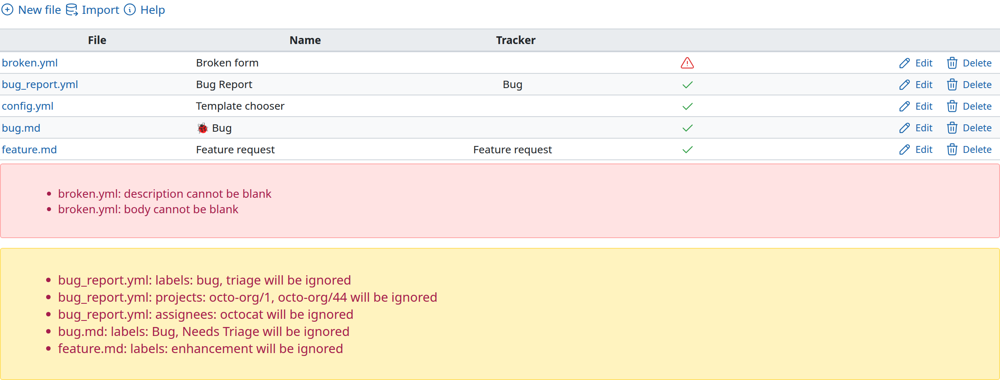
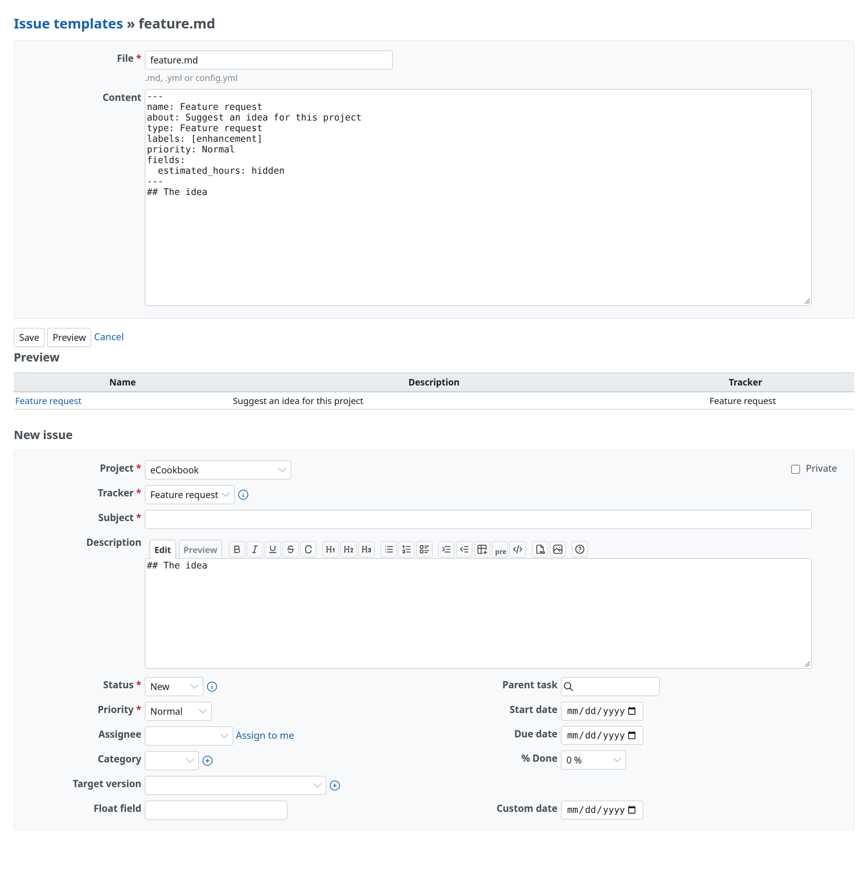

# Redmine Issue Template

Redmine Issue Template adds issue templates to Redmine. When a project has templates, "New issue" opens a template chooser. The chosen template fills in Redmine's issue form: the tracker (bug, feature…), the subject, the description, and the fields it sets. A YAML form shows its own fields and writes the answers into the description.

The templates are files in the project's repository. Redmine reads `.redmine/ISSUE_TEMPLATE/`, or `.github/ISSUE_TEMPLATE/` when there is no `.redmine/` folder, and imports the files again when the repository changes. A project without a repository edits the same files in its settings.

## Pages

| Page | Contents |
| --- | --- |
| [Setup](setup.md) | Requirements, installation, configuration and tests |
| [Template format](format.md) | Markdown templates, YAML forms, `config.yml`, Redmine's keys and the other keys |
| [Import and sync](sync.md) | Where the templates come from, when they are imported, and Redmine GitHub |
| [Design](design.md) | Goals, decisions and what is not covered |

## Screens

"New issue" opens the template chooser. It lists the templates with their descriptions and trackers, the blank issue when `config.yml` allows it, and the contact links of `config.yml`.

A YAML form shows its fields after the issue's attributes. When the issue is created, the answers become the description, each under the field's label.

The "Issue templates" tab of the project settings shows where the templates come from, the last import, and each file with its errors and warnings.

A file of the project settings is edited as text. "Preview" shows the template's row in the chooser and the New issue form it makes, without saving.

## Sponsors

<Sponsors ids="keyselect"><a href="https://www.keyselect.co.jp/">KEY SELECT</a></Sponsors>

## License

Redmine Issue Template is released under the GNU General Public License, version 2 or (at your option) any later version. See [LICENSE](../LICENSE). An unofficial Redmine plugin.
