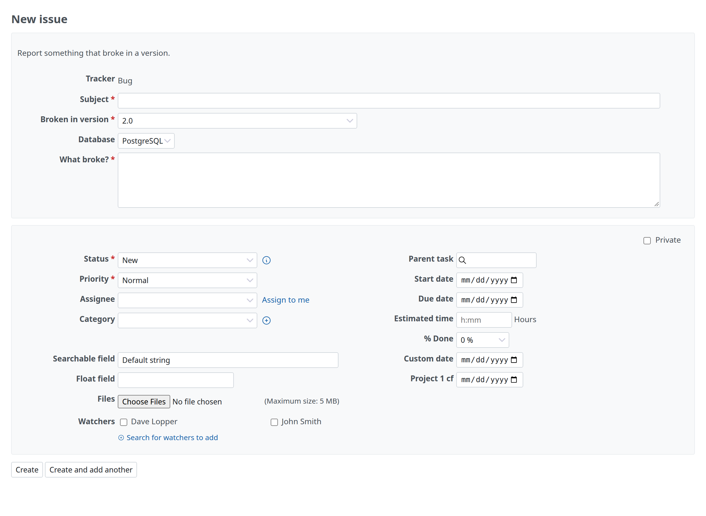

# Template format

The templates are Markdown templates, YAML forms and `config.yml`. The files of `.github/ISSUE_TEMPLATE/` are read as they are. Redmine's own keys, such as the tracker and the priority, are top-level keys next to the others ([Redmine keys](#redmine-keys)).

## Folder

Redmine reads the first of these folders that has template files, on the default branch of the project's repository:

1. `.redmine/ISSUE_TEMPLATE/`
2. `.github/ISSUE_TEMPLATE/`

The folders are not merged. To use templates in Redmine other than those in `.github/ISSUE_TEMPLATE/`, put them in `.redmine/ISSUE_TEMPLATE/`. A YAML form that uses Redmine's keys belongs in `.redmine/ISSUE_TEMPLATE/`: GitHub rejects issue forms with top-level keys it does not permit.

The chooser lists YAML forms (`.yml`, `.yaml`) first, then Markdown templates (`.md`), each sorted by file name. Prefix the file names with numbers to set the order (`1-bug.yml`, `2-feature.md`). The file name without its extension is the template's id in URLs (`?issue_template=1-bug`).

## Markdown templates

A Markdown template has YAML front matter and the description the form starts with. `name` and `about` are required.

```markdown
---
name: 🐞 Bug
about: File a bug/issue
title: '[BUG] <title>'
labels: Bug, Needs Triage
assignees: ''
---

### Current Behavior:
<!-- A concise description of what you're experiencing. -->

### Steps To Reproduce:
```

## YAML forms

A YAML form has `name`, `description` and `body`, and optionally `title`, `labels`, `assignees`, `type` and `projects`. The form shows its fields in place of the description, and the answers become the description when the issue is created.

On the "New issue" page, a box above Redmine's form holds the form: its `description`, the `markdown` elements it starts with, the tracker, the subject and the fields. Redmine's box below holds the issue's other attributes, the files and the watchers. This example is from GitHub's documentation:

```yaml
name: Bug Report
description: File a bug report.
title: "[Bug]: "
labels: ["bug", "triage"]
type: bug
body:
  - type: markdown
    attributes:
      value: |
        Thanks for taking the time to fill out this bug report!
  - type: textarea
    id: what-happened
    attributes:
      label: What happened?
      description: Also tell us, what did you expect to happen?
      value: "A bug happened!"
    validations:
      required: true
  - type: dropdown
    id: version
    attributes:
      label: Version
      options:
        - 1.0.2 (Default)
        - 1.0.3 (Edge)
      default: 0
    validations:
      required: true
  - type: checkboxes
    id: terms
    attributes:
      label: Code of Conduct
      options:
        - label: I agree to follow this project's Code of Conduct
          required: true
```

### Fields

The body has these element types. Each one has `attributes` and, except `markdown`, an optional `id` (letters, digits, `-`, `_`) and `validations`.

| Type | Attributes | Validations | In the form |
| --- | --- | --- | --- |
| `markdown` | `value` | none | Text, not submitted |
| `textarea` | `label`, `description`, `placeholder`, `value`, `render` | `required`, `min_length` | A text area; with `render`, the answer becomes a code block in that language |
| `input` | `label`, `description`, `placeholder`, `value` | `required`, `min_length` | A one-line text field |
| `dropdown` | `label`, `description`, `multiple`, `options`, `default` | `required` | A select box; `default` is the index of the preselected option |
| `checkboxes` | `label`, `description`, `options` (each with `label` and `required`) | `required` | A checkbox per option |
| `upload` | `label`, `description` | `required`, `accept` | Redmine's Files field of the issue; the section lists the attached files |

`validations` are always checked when the issue is created.

### The description

The answers are written in Markdown: a `### <label>` heading for each field, then the answer. An empty answer is `_No response_`. A dropdown's chosen options are separated by commas, and each checkbox option becomes `- [X] <label>` or `- [ ] <label>`.

```markdown
### What happened?

It crashed.

### Version

1.0.2 (Default)

### Code of Conduct

- [X] I agree to follow this project's Code of Conduct
```

### Checks

Each file is checked: the required keys, the permitted keys and attributes, unique ids and labels, labels that stay different when made into parameters, at least one field that is not `markdown`, distinct dropdown options without the reserved word `None` and without values YAML reads as booleans, keys that YAML reads as booleans (`yes`, `no`, `on`, `off`…), a `name` longer than 3 characters, at most 65,535 characters per file, and no two files with the same id (`bug.yml` and `bug.md`; the first in the chooser's order keeps it). A file that breaks a rule is marked in the project settings, with its errors on its page, and left out of the chooser; the other files still work.

Each problem is shown as the file, the key and Redmine's validation message, for example `bug.yml: body[2]: id is invalid` or `bug.yml: description cannot be blank`. The "Help" link of the project settings opens this page.

## config.yml

`config.yml` sets the chooser. Without it, blank issues are allowed.

```yaml
blank_issues_enabled: false
contact_links:
  - name: GitHub Community Support
    url: https://github.com/orgs/community/discussions
    about: Please ask and answer questions here.
```

- `blank_issues_enabled: false` hides "Blank issue" from the chooser, and an issue created in the browser without a template goes back to the chooser. Users with "Manage issue templates" can still create one. Issues from the REST API and from email are not affected.
- `contact_links` are listed after the templates, under "Other contacts".

The project settings show these settings under "Template chooser". When the templates are edited in Redmine, they can be changed there: saving makes `config.yml` again from the form, without its comments. Templates from a repository or GitHub keep `config.yml` there.

## Redmine keys

Redmine's keys are top-level keys, in a Markdown template's front matter or in a YAML form, next to `name` and the other keys.

```yaml
tracker: Bug
priority: High
category: UI
fixed_version: "2.0"
is_private: false
custom_fields:
  Severity: Major
fields:
  assigned_to: hidden
  estimated_hours: hidden
  due_date: required
  Severity: required
```

| Key | Value |
| --- | --- |
| `tracker` | The tracker, by name or id |
| `priority` | The priority, by name or id |
| `category` | A category of the project, by name or id |
| `fixed_version` | An open version of the project, by name or id |
| `is_private` | `true` or `false` |
| `custom_fields` | Custom field names (or ids) and their values |
| `fields` | The visibility of the form's fields |

Names are compared without case. A name that the project doesn't have is reported as a warning in the project settings, and the field keeps Redmine's default.

The values these keys set can't be changed in the form: the form shows them as text, as Redmine shows a field the user can't change, and the issue gets the template's value whatever the request says. `title`, the body of a Markdown template and `assignees` are only what the form starts with, and can be changed.

### Fields of the form

`fields` sets a field to `shown` (the default), `hidden` or `required`. A hidden field is left out of the form and gets the value the template sets, when Redmine lets the user set that field; a required field is marked and checked as Redmine marks and checks the fields its workflow requires. The names are `assigned_to`, `category`, `fixed_version`, `parent_issue`, `start_date`, `due_date`, `estimated_hours`, `done_ratio`, `description` (Markdown templates; a YAML form always replaces it), `priority`, `is_private`, `watchers`, and custom fields by name or id.

The tracker and the subject are always shown, as Redmine requires them: the tracker as text when the template sets it. The project can't be changed while a template applies, since the template's values belong to the project it was chosen in. Redmine's own rules still apply: a field the tracker disables is not shown even when the template shows it, and a field the workflow makes read-only stays read-only.

### Links

In a YAML form, `link` on an `input`, `textarea` or `dropdown` element links the field to a field of the issue. The answer sets that field, the form leaves the issue's field out, and the answer is not written into the description.

```yaml
body:
  - type: dropdown
    id: version
    link: fixed_version
    attributes:
      label: Version
    validations:
      required: true
  - type: input
    id: due
    link: due_date
    attributes:
      label: When do you need it?
```



| `link` | The field it sets |
| --- | --- |
| `priority`, `category`, `fixed_version`, `assigned_to`, `done_ratio` | The issue's field of that name, from a dropdown |
| `start_date`, `due_date`, `estimated_hours` | The issue's field of that name, from an input |
| A custom field's name or id | The custom field |

- A linked dropdown without `options` offers the field's choices: the project's priorities, categories, open versions or assignable users, or the custom field's values. With `options`, each option sets the choice of the same name, compared without case.
- A link that the project doesn't have is reported as a warning on the template's page; the field's answer then goes into the description.
- Links follow Redmine's rules for the user: a field the workflow makes read-only, a field the tracker disables or a custom field the user can't see is not linked. Its answer goes into the description, and a dropdown without `options` is left out, having nothing to choose.
- A blank answer leaves the field's default. Of two links to the same field, the first sets it.
- Like the [Redmine keys](#redmine-keys), `link` belongs in `.redmine/ISSUE_TEMPLATE/` or in the project settings. Keep the files of `.github/ISSUE_TEMPLATE/` without it.

## Other keys

Some keys have no Redmine equivalent. They don't stop a template from working; the project settings list them as warnings.

| Key | In Redmine |
| --- | --- |
| `name` | The template's name in the chooser |
| `about`, `description` | The template's description in the chooser |
| `title` | The subject the form starts with |
| `type` | The tracker of the same name, unless `tracker` is set |
| `labels` | Not used, with a warning |
| `assignees` | The first entry that can be assigned in the project becomes the assignee: a user by login, or a group by name when Redmine allows assigning issues to groups. Entries that can't be assigned are reported as a warning |
| `projects` | Ignored, with a warning |
| Markdown template body | The description the form starts with |
| YAML form `body` | The form's fields; the answers become the description |
