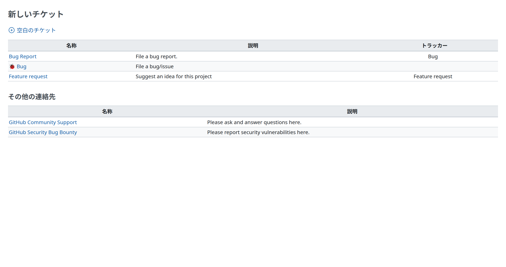
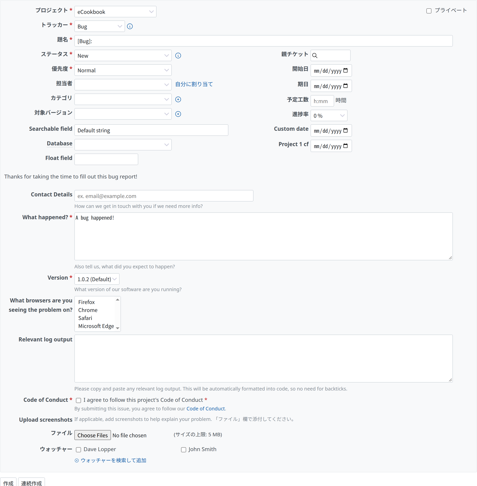
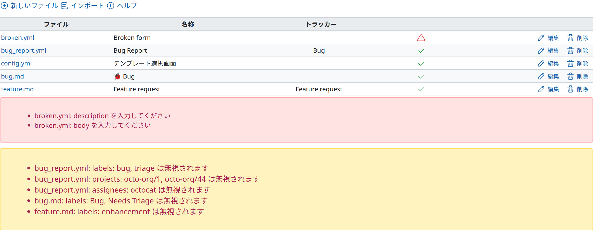
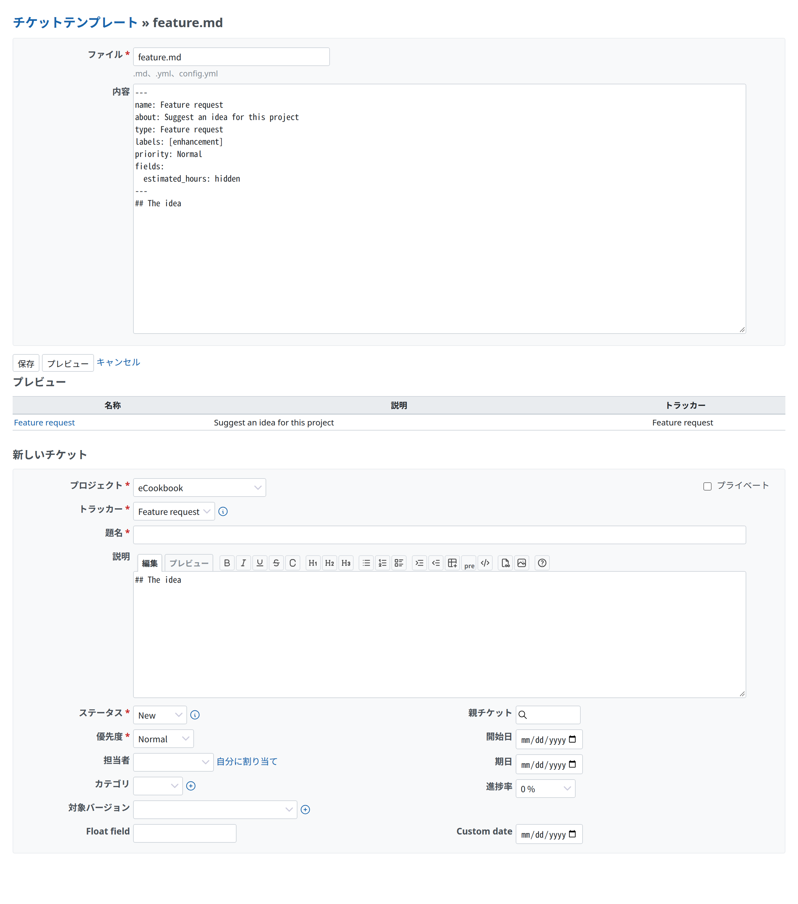

# Redmine Issue Template

Redmine Issue Template は、Redmine にチケットテンプレートを加えるプラグインです。プロジェクトにテンプレートがあると、「新しいチケット」を押したときにテンプレート選択画面が開きます。選んだテンプレートは、チケットの入力画面に、トラッカー(バグ、機能など)、題名、説明、テンプレートで決めた項目を入れます。YAML フォームは自分の入力欄を出し、チケットを作るときに、その回答を説明に書きます。

テンプレートファイルは、プロジェクトのリポジトリに置きます。Redmine は `.redmine/ISSUE_TEMPLATE/` を読み、`.redmine/` がなければ `.github/ISSUE_TEMPLATE/` を読みます。リポジトリが変わると、ファイルを取り込み直します。リポジトリのないプロジェクトは、同じファイルをプロジェクトの設定で編集します。

## ページ

| ページ | 内容 |
| --- | --- |
| [導入](setup.md) | 動作環境、インストール、設定、テスト |
| [テンプレートの形式](format.md) | Markdown テンプレート、YAML フォーム、`config.yml`、Redmine のキーとほかのキー |
| [取り込みと同期](sync.md) | テンプレートの取得元、取り込むタイミング、Redmine GitHub との連携 |
| [設計](design.md) | 目的、決定事項、対象外 |

## 画面

「新しいチケット」を押すと、テンプレート選択画面が開きます。テンプレートの名前、説明、トラッカーの一覧と、`config.yml` で許していれば「空白のチケット」、`config.yml` のその他の連絡先(`contact_links`)が並びます。

YAML フォームは、チケットの属性の後に自分の入力欄を出します。チケットを作ると、回答は入力欄のラベルごとに説明に書かれます。

プロジェクトの設定の「チケットテンプレート」タブには、テンプレートの取得元、最後の取り込み、ファイルごとのエラーと警告が出ます。

プロジェクトの設定のファイルは、テキストのまま編集します。「プレビュー」は、保存せずに、選択画面でのテンプレートの行と、テンプレートを当てた新しいチケットの入力画面を出します。

## スポンサー

<Sponsors ids="keyselect"><a href="https://www.keyselect.co.jp/">KEY SELECT</a></Sponsors>

## ライセンス

Redmine Issue Template は、GNU General Public License バージョン 2 またはそれ以降のバージョンで公開しています。[LICENSE](../../LICENSE) を参照してください。Redmine の非公式のプラグインです。
