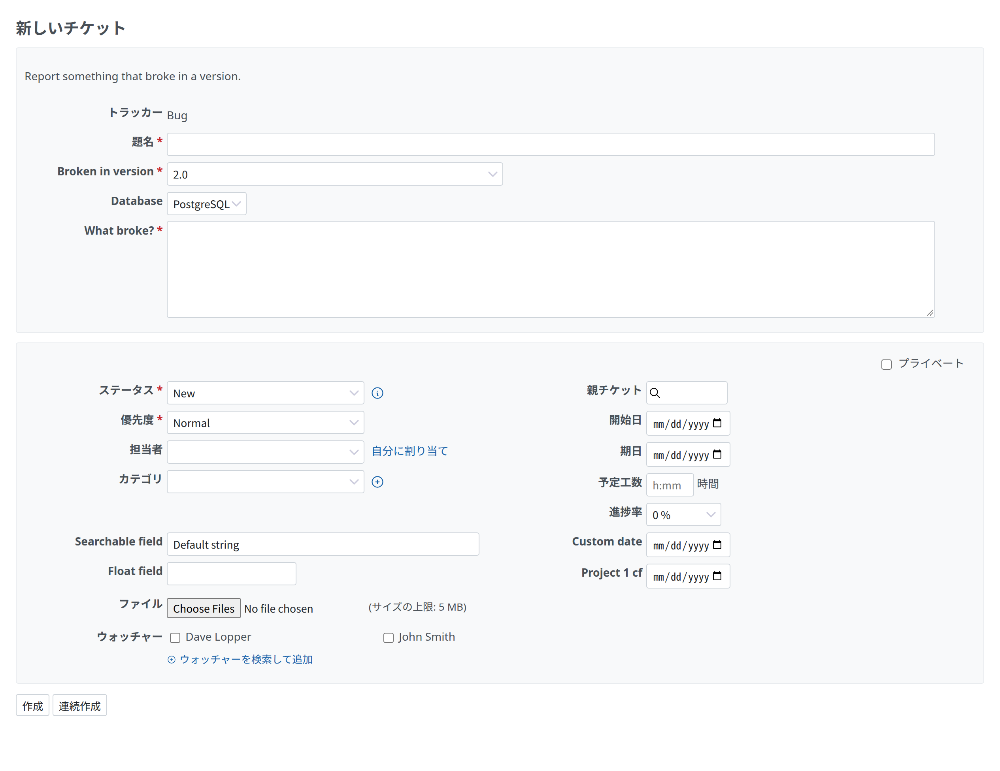

# テンプレートの形式

テンプレートは Markdown テンプレート、YAML フォーム、`config.yml` です。`.github/ISSUE_TEMPLATE/` のファイルも、そのまま読めます。トラッカーや優先度などの Redmine のキーは、ほかのキーと同じ一番上の階層に書きます([Redmine のキー](#redmine-keys))。

<a id="folder"></a>

## フォルダー

Redmine は、プロジェクトのリポジトリのデフォルトブランチで、次のうちテンプレートファイルがある最初のフォルダーを読みます。

1. `.redmine/ISSUE_TEMPLATE/`
2. `.github/ISSUE_TEMPLATE/`

2 つのフォルダーは混ぜません。`.github/ISSUE_TEMPLATE/` と別のテンプレートを Redmine で使うときは、`.redmine/ISSUE_TEMPLATE/` に置きます。Redmine のキーを使う YAML フォームは `.redmine/ISSUE_TEMPLATE/` に置きます。`.github/ISSUE_TEMPLATE/` のファイルは、GitHub の書式のままにします。

テンプレート選択画面には、YAML フォーム(`.yml`、`.yaml`)が先、Markdown テンプレート(`.md`)が後で、それぞれファイル名の順です。順番を決めるには、ファイル名の先頭に番号を付けます(`1-bug.yml`、`2-feature.md`)。拡張子を除いたファイル名が、URL でのテンプレートの ID になります(`?issue_template=1-bug`)。

<a id="markdown-templates"></a>

## Markdown テンプレート

Markdown テンプレートは、YAML の front matter と、入力画面に最初から入る説明でできています。`name` と `about` は必須です。

```markdown
---
name: 🐞 Bug
about: File a bug/issue
title: '[BUG] <title>'
labels: Bug, Needs Triage
assignees: ''
---

### Current Behavior:
<!-- A concise description of what you're experiencing. -->

### Steps To Reproduce:
```

<a id="yaml-forms"></a>

## YAML フォーム

YAML フォームは、`name`、`description`、`body` を持ちます。`title`、`labels`、`assignees`、`type`、`projects` も書けます。YAML フォームは説明の代わりに自分の入力欄を出し、チケットを作るときに、その回答を説明に書きます。

「新しいチケット」の画面では、Redmine のフォームの上のボックスに、YAML フォームの `description`、先頭の `markdown` 要素、トラッカー、題名、入力欄が入ります。下の Redmine のボックスには、チケットのほかの属性、ファイル、ウォッチャーが入ります。次の例は GitHub のドキュメントからの引用です。

```yaml
name: Bug Report
description: File a bug report.
title: "[Bug]: "
labels: ["bug", "triage"]
type: bug
body:
  - type: markdown
    attributes:
      value: |
        Thanks for taking the time to fill out this bug report!
  - type: textarea
    id: what-happened
    attributes:
      label: What happened?
      description: Also tell us, what did you expect to happen?
      value: "A bug happened!"
    validations:
      required: true
  - type: dropdown
    id: version
    attributes:
      label: Version
      options:
        - 1.0.2 (Default)
        - 1.0.3 (Edge)
      default: 0
    validations:
      required: true
  - type: checkboxes
    id: terms
    attributes:
      label: Code of Conduct
      options:
        - label: I agree to follow this project's Code of Conduct
          required: true
```

<a id="fields"></a>

### 入力欄

body には次の入力の種類を使えます。どれも `attributes` を持ち、`markdown` 以外は `id`(英数字、`-`、`_`)と `validations` を持てます。`link` を書いた入力欄には種類を書きません([項目とのつなぎ込み](#links))。

| 種類 | 属性 | 検証 | 入力画面での形 |
| --- | --- | --- | --- |
| `markdown` | `value` | なし | 説明の文。送信はしない |
| `textarea` | `label`、`description`、`placeholder`、`value`、`render` | `required`、`min_length` | 複数行の入力欄。`render` があると、回答はその言語のコードブロックになる |
| `input` | `label`、`description`、`placeholder`、`value` | `required`、`min_length` | 1 行の入力欄 |
| `dropdown` | `label`、`description`、`multiple`、`options`、`default` | `required` | 選択欄。`default` は最初に選ぶ選択肢の番号 |
| `checkboxes` | `label`、`description`、`options`(それぞれ `label` と `required`) | `required` | 選択肢ごとのチェックボックス |
| `upload` | `label`、`description` | `required`、`accept`(読むが、まだ検証しない) | チケットの「ファイル」の欄を使う。説明には添付したファイルを並べる |

`validations` は、チケットを作るときに常に検証します。

<a id="the-description"></a>

### 説明への書き方

回答は Markdown で書きます。入力欄ごとに `### <label>` の見出しを置き、その下に回答を書きます。空の回答は `_No response_` です。選択欄で選んだ選択肢はカンマで区切り、チェックボックスの選択肢は `- [X] <label>` か `- [ ] <label>` になります。

```markdown
### What happened?

It crashed.

### Version

1.0.2 (Default)

### Code of Conduct

- [X] I agree to follow this project's Code of Conduct
```

<a id="checks"></a>

### 検証

ファイルごとに入力チェックを行います。必須のキー、使えるキーと属性、`id`、`label`、`link` の重複、回答を送る名前(`id`、またはパラメーターにした `label`)の重複、`markdown` 以外の入力欄が 1 つ以上あること、選択欄の選択肢の重複と予約語 `None`、YAML で真偽値になる選択肢、YAML で真偽値になるキー(`yes`、`no`、`on`、`off` など)、`true` か `false` の `required` と数値の `min_length`、`type` を書かず文字列の `link` を書いた入力欄、選択欄と同じ規則の `link` の `options`、選択肢の番号の `dropdown` の `default`、`true` か `false` の `is_private` と `blank_issues_enabled`、`shown`、`hidden`、`required` のどれかの `fields` の値、YAML フォームの 4 文字以上の `name`、テンプレートの名前の重複、`http` か `https` の URL の連絡先、1 ファイル 65,535 文字まで、同じ id のファイルがないこと(`bug.yml` と `bug.md`。選択画面の順で先のものが使われます)です。規則に合わないファイルは、プロジェクトの設定で印を付け、エラーはそのファイルの画面に表示し、選択画面には出しません。ほかのファイルはそのまま使えます。

問題は、ファイル、キー、Redmine の検証のメッセージで表示します。たとえば `bug.yml: body[2]: id は不正な値です`、`bug.yml: description を入力してください` です。プロジェクトの設定の「ヘルプ」から、このページを開けます。

<a id="config-yml"></a>

## config.yml

`config.yml`(または `config.yaml`)で選択画面を設定します。ファイルがなければ、空白のチケットを作れます。

```yaml
blank_issues_enabled: false
contact_links:
  - name: GitHub Community Support
    url: https://github.com/orgs/community/discussions
    about: Please ask and answer questions here.
```

- `blank_issues_enabled: false` にすると、選択画面に「空白のチケット」を出さず、画面からテンプレートを使わずに作成しようとすると選択画面に戻します。ただし、「チケットテンプレートの管理」の権限を持つユーザーは作成できます。REST API とメールからのチケットの作成は変わりません。
- `contact_links` は、テンプレートの後に「その他の連絡先」として並びます。連絡先の `about` は Markdown で、複数行で書けます。

プロジェクトの設定の「テンプレートの選択画面」に、これらの設定を表示します。テンプレートを Redmine で編集しているときはそこで変更でき、保存すると画面の内容から `config.yml` を作り直します(コメントは残りません)。リポジトリや GitHub から取り込んだテンプレートでは、`config.yml` はそちらで編集します。

<a id="redmine-keys"></a>

## Redmine のキー

Redmine のキーは、Markdown テンプレートでは front matter に、YAML フォームでは一番上の階層に、`name` などのほかのキーと並べて書きます。

```yaml
tracker: Bug
priority: High
category: UI
fixed_version: "2.0"
is_private: false
custom_fields:
  Severity: Major
fields:
  assigned_to: hidden
  estimated_hours: hidden
  due_date: required
  Severity: required
```

| キー | 値 |
| --- | --- |
| `tracker` | トラッカー。名前か ID |
| `priority` | 優先度。名前か ID |
| `category` | プロジェクトのカテゴリ。名前か ID |
| `fixed_version` | プロジェクトの未完了のバージョン。名前か ID |
| `is_private` | `true` か `false`。Redmine の入力画面と同じく、「チケットのプライベート設定」の権限を持つユーザーにだけ効く |
| `custom_fields` | カスタムフィールドの名前(か ID)と値 |
| `fields` | 入力欄の表示 |

名前は大文字と小文字を区別せずに比べます。プロジェクトにない名前は、テンプレートの画面に警告として出し、その項目は Redmine のデフォルトのままになります。

これらのキーで決めた値は、画面では変更できません。Redmine が変更できない項目を表示するときと同じように文字で表示し、送られてきた値にかかわらず、テンプレートの値をチケットに入れます。`title`、Markdown テンプレートの本文、`assignees` は、画面に最初に入る値なので、変更できます。

<a id="fields-of-the-form"></a>

### 入力欄の表示

`fields` では、入力欄ごとに `shown`(デフォルト)、`hidden`、`required` を決めます。`hidden` の入力欄は画面に出さず、Redmine の規則でそのユーザーが設定できる項目なら、テンプレートで決めた値を入れます。`required` の入力欄は、ユーザーが設定できる項目なら、Redmine のワークフローで必須にした項目と同じように、印を付けて検証します。`priority` と `is_private` は `required` にできません。Redmine が必須にしていて、テンプレートが値を決めていない `hidden` の項目は、入力できるように表示します。指定できる名前は `assigned_to`(担当者)、`category`(カテゴリ)、`fixed_version`(対象バージョン)、`parent_issue`(親チケット)、`start_date`(開始日)、`due_date`(期日)、`estimated_hours`(予定工数)、`done_ratio`(進捗率)、`description`(説明。Markdown テンプレートだけで、YAML フォームでは常に入力欄に置き換わる)、`priority`(優先度)、`is_private`(プライベート)、`watchers`(ウォッチャー)と、カスタムフィールドの名前か ID です。

トラッカーと題名は、Redmine が必須にしているので、いつも表示します。トラッカーは、テンプレートで決めたときは文字で表示します。プロジェクトは、テンプレートを使っている間は変更できません。テンプレートの値は、テンプレートを選んだプロジェクトのものだからです。Redmine の規則もそのまま効きます。トラッカーで無効にした項目は、テンプレートで `shown` にしても出ず、ワークフローで読み取り専用にした項目は読み取り専用のままです。ユーザーが使えないトラッカーのテンプレートは、選択画面に出しません。

<a id="links"></a>

### 項目とのつなぎ込み

YAML フォームで、`type` を書かずに `link` を書いた入力欄は、チケットの項目につながります。表示はつなぎ先で決まり、項目の選択肢の選択欄、日付、テキストエリア(長いテキストのカスタムフィールド)、1 行の入力欄のどれかになります。回答はその項目に入り、画面からはチケットの項目を外し、回答は説明に書きません。書ける属性は `label`、`description`、`placeholder`(文字の入力欄)、`options` で、検証は `required` です。

```yaml
name: Regression
description: Report something that broke in a version.
type: Bug
body:
  - id: version
    link: fixed_version
    attributes:
      label: Broken in version
    validations:
      required: true
  - id: database
    link: Database
    attributes:
      label: Database
  - type: textarea
    id: what
    attributes:
      label: What broke?
    validations:
      required: true
```



| `link` | 入る項目 | 表示 |
| --- | --- | --- |
| `priority`、`category`、`fixed_version`、`assigned_to`、`done_ratio` | チケットの同じ名前の項目(優先度、カテゴリ、対象バージョン、担当者、進捗率) | 選択欄 |
| `start_date`、`due_date` | チケットの同じ名前の項目(開始日、期日) | 日付 |
| `estimated_hours` | 予定工数 | 1 行の入力欄 |
| カスタムフィールドの名前か ID | そのカスタムフィールド(ファイルの形式は除く) | 形式で決まる。リスト、ユーザー、バージョン、真偽値は選択欄、日付は日付、長いテキストはテキストエリア、それ以外は 1 行の入力欄 |

- 選択欄は、その項目の選択肢を出します。プロジェクトの優先度、カテゴリ、未完了のバージョン、担当者にできるユーザー、カスタムフィールドの値、Redmine の刻みの進捗率(ステータスで決めないとき)です。`options` を書くと、同じ名前(大文字と小文字を区別しない)か同じ値の選択肢だけを残します。どれも当たらなければ、すべての選択肢を残します。
- つなぎ込みは、ユーザーに対する Redmine の規則に従います。ワークフローで読み取り専用にした項目、トラッカーで無効にした項目、ユーザーが見られないカスタムフィールドにはつなぎません。プロジェクトにないつなぎ先は、テンプレートの画面に警告として出します。そうした入力欄は、`options` があればその選択欄にして回答を説明に書き、なければ出しません。
- 選択欄の選択肢にない回答は無視します。ほかの値は、Redmine の入力画面と同じく Redmine が検証します。数値でない値、ワークフローで必須の項目などです。
- 空の回答は、項目のデフォルトのままにします。同じ `link` は 2 つの入力欄に書けません。名前と ID で同じ項目を指したときは、最初のものが入ります。
- `link` は、[Redmine のキー](#redmine-keys)と同じく、`.redmine/ISSUE_TEMPLATE/` かプロジェクトの設定で使います。`.github/ISSUE_TEMPLATE/` のファイルには書きません。

<a id="other-keys"></a>

## ほかのキー

キーには、Redmine に当たるものがないものもあります。そうしたキーがあってもテンプレートは使え、テンプレートの画面に警告として出ます。

| キー | Redmine では |
| --- | --- |
| `name` | 選択画面でのテンプレートの名前 |
| `about`、`description` | 選択画面と入力画面の上に出すテンプレートの説明。Markdown で書ける |
| `title` | 入力画面に最初から入る題名 |
| `type` | 同じ名前のトラッカー。`tracker` があればそちらを使う |
| `labels` | 使わず、警告を出す |
| `assignees` | プロジェクトで担当者にできる最初の項目が、担当者になる。ユーザーはログイン、グループは名前で探す。グループは、Redmine でグループへのチケット割り当てを許可しているときだけ。担当者にできない項目は警告を出す |
| `projects` | 使わず、警告を出す |
| Markdown テンプレートの本文 | 入力画面に最初から入る説明 |
| YAML フォームの `body` | 入力画面の入力欄。回答は説明になる |
